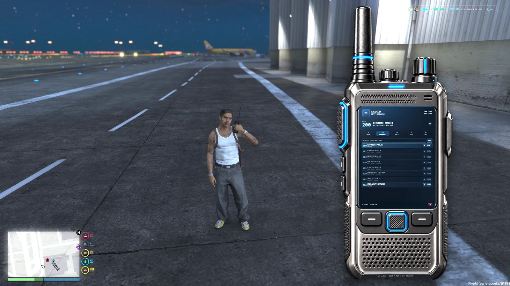
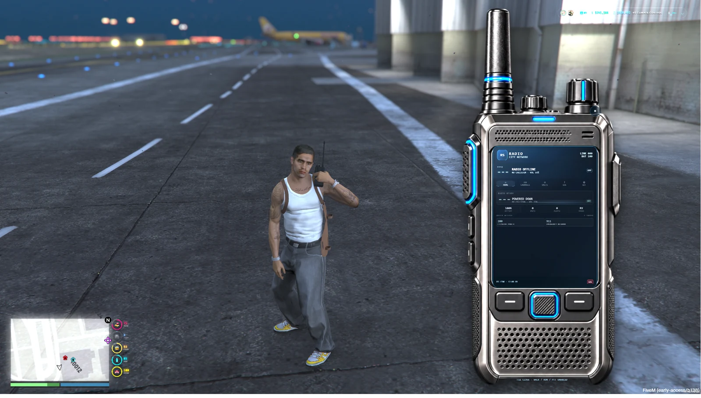
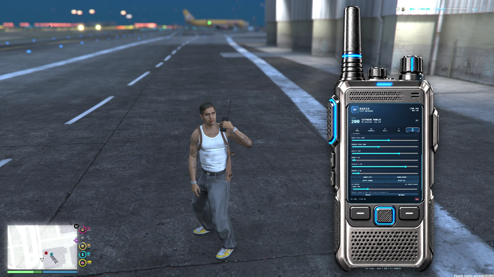

# RS Radio — Modern Walkie Talkie

<a href="https://reality-sucks-rp-webstore.tebex.io/package/7706219"></a>

Keep emergency services, gangs, businesses and civilian groups talking. RS Radio pairs an interactive handheld interface with pma-voice, restricted channels, live unit rosters and GPS emergency alerts. Persistent profiles, rechargeable batteries and RF jammers add more ways to build communication RP.

[Download the original ZIP](https://github.com/RealitySucksRP/rs-radio/releases/latest/download/rs-radio.zip) | [Free on Tebex](https://reality-sucks-rp-webstore.tebex.io/package/7706219) | [Watch preview](https://www.youtube.com/watch?v=KuSvMqt7jnw) | [Website](https://realitysucksrp.github.io/) | [Discord](https://discord.gg/e9V3rPHySx) | [YouTube](https://www.youtube.com/@RealitySucksRP) | [All free scripts](https://reality-sucks-rp-webstore.tebex.io/category/free-scripts)

**Install folder:** `rs-radio`. Download the original ZIP to retain the package folder layout. Source, configuration, licenses and included assets are provided below.

<details>
<summary>More screenshots</summary>





</details>

## Package documentation

# RS Radio

**RealitySucksRP — free Cfx/FiveM release**

RS Radio is a standalone modern handheld radio system for FiveM with server-authoritative channel access, two current voice transports, unit telemetry, distress traffic, persistent profiles and batteries, deployable RF jammers, and framework/inventory bridges in one resource.

## Voice architecture

`Config.Voice.Backend = 'auto'` is the default.

| Runtime | Automatic transport | Radio channel ownership |
|---|---|---|
| GTA V Enhanced | Cfx server voice API | server-only |
| GTA V Legacy | `pma-voice` | RS access checks + pma server checks |

### GTA V Enhanced

RS Radio uses the current Cfx server-side voice API when `CreateVoiceChannel`, `AddPlayerToVoiceChannel`, `RemovePlayerFromVoiceChannel`, `SetPlayerMutedInVoiceChannel`, and `SetPlayerDeafInVoiceChannel` are available.

The player never performs a voice-channel join. A client may only request PTT on/off; the server confirms the player still has a valid RS session and controls channel membership and transmit/deaf state. New channels are non-spatial radio channels created with `CreateVoiceChannel(0, 0.0)`.

Required server configuration:

```cfg
voice_internal
ensure rs-radio
```

Do **not** enable `sv_mumble` just for RS Radio on Enhanced. Cfx documents the Mumble compatibility layer as deprecated and warns that enabling it permits client-controlled voice channels. RS Radio does not require it when the native Enhanced API is available.

The current documented Enhanced voice API does not expose a radio-only per-listener volume override or per-listener mute control. In native mode RS Radio therefore disables those two controls instead of pretending they work. Radio deafen and PTT remain server-owned.

### GTA V Legacy

Legacy uses `pma-voice`:

```cfg
setr voice_enableRadios 1
setr voice_enableProximityCycle 0
ensure pma-voice
ensure rs-radio
```

`voice_enableProximityCycle 0` is recommended because `pma-voice` commonly uses F11 for proximity cycling while RS Radio uses F11 to open/close by default. Rebind either action if you want proximity cycling enabled.

## Framework and inventory support

One resource supports:

| Framework | Inventory | Status |
|---|---|---|
| Qbox (`qbx_core`) | `ox_inventory` | supported |
| QBCore (`qb-core`) | framework inventory / `ox_inventory` | supported |
| ESX (`es_extended`) | framework inventory / `ox_inventory` | supported |
| Standalone | custom provider | supported |

`Config.Framework = 'auto'` and `Config.Inventory = 'auto'` are the defaults. Qbox is detected before QBCore compatibility. No external RS bridge is required.

`Config.RequireRadioItem = false` makes RS Radio itself the device. Set it to `true` only when the server intentionally requires a physical inventory item.

## Major features

- Server-authoritative joins/leaves and access validation.
- Public, team, role, job, gang, and ACE channel permissions.
- Current Cfx server-owned Enhanced radio channels.
- `pma-voice` Legacy compatibility with server channel checks and external-channel reconciliation.
- PTT talking state, stuck-transmit timeout, and server-enforced jammer cut-off.
- Unit roster with callsign, role, talking state, location, distance, signal, condition, and last-known state.
- Medical/privacy-aware telemetry with optional `rs-bodyhealth` integration and native fallback.
- Persistent per-character profiles, favorites, recents, layout, overlay, and display name.
- Persistent battery/device identity.
- Emergency/distress board with configurable recipient rules and GPS routing.
- Deployable/persistent RF jammers, routing-bucket awareness, pass-through channels, damage/removal handling, and server permissions.
- Granular server-written state bags: `rsRadioChannel`, `rsRadioTalking`, `rsRadioEmergency`, `rsRadioJammed`, `rsRadioCallsign`.
- Central NUI RPC dispatcher with request IDs, timeouts, error isolation, and guaranteed callback responses.
- Reactive framework access reevaluation when jobs, gangs, metadata, or group state changes.
- Recovery when the configured Legacy voice resource restarts.
- Movement passthrough while NUI is focused with combat controls suppressed.
- Remappable FiveM key mappings.
- JSON persistence with automatic Cfx resource-KVP fallback on read-only resource hosts; no SQL dependency.

## Default controls

- **F11** — open/close RS Radio.
- **Left Alt (LMENU)** — radio PTT on the Enhanced native backend. Legacy PTT is handled by `pma-voice`.
- **Period** — next accessible configured frequency.
- **Comma** — previous accessible configured frequency.
- **Escape** — close the NUI.
- Number keys + **Enter** — direct tune while open.

All mappings can be changed in FiveM key bindings.

## Default channels

These are examples. Change them in `config.lua`.

| Frequency | Default use |
|---:|---|
| 101 | LSPD Dispatch |
| 102 | BCSO Dispatch |
| 110 | EMS Dispatch |
| 111 | Fire Dispatch |
| 120 | Emergency Interop |
| 200 | Citywide Public |
| 201 | Services Net |
| 911 | Emergency Network |

## Installation

1. Keep the folder name `rs-radio`.
2. Put it in your server resources folder.
3. Configure the voice path for your runtime using the examples above.
4. Add `ensure rs-radio` after required framework/inventory resources.
5. Leave `Config.RequireRadioItem = false` for universal access, or set it to `true` and use the examples in `install/`.
6. Review `Config.JobTeams`, `Config.Teams`, `Config.Channels`, distress recipients, jammer permissions, and key mappings.
7. For validation, set `Config.EnableDiagnosticCommand = true`, restart the resource, and run `/rsradiodiag`. The detailed command is disabled in the supplied release config. `/rsradiostate` is enabled by default.

## Configuration highlights

```lua
Config.Framework = 'auto' -- auto, qbcore, qbox, esx, standalone
Config.Inventory = 'auto' -- auto, ox_inventory, framework, standalone

Config.Voice = {
    Backend = 'auto', -- auto, cfx-native, pma-voice
    Resource = 'pma-voice',
    NativePTTKey = 'LMENU',
    NativePTTCommand = '+rs_radio_talk',
    MaxTransmitSeconds = 120
}
```

Force `pma-voice` only on a server that intentionally wants that compatibility path. On Enhanced this requires the deprecated Mumble compatibility layer and gives up the security advantage of server-owned native voice channels.

## Inventory examples

### ox_inventory / Qbox

```lua
['radio'] = {
    label = 'RS Radio',
    weight = 850,
    stack = false,
    close = true,
    consume = 0,
    description = 'A modern handheld radio for city communications.',
    client = { export = 'rs-radio.useRadio' }
},

['radiocell'] = {
    label = 'Radio Battery Cell',
    weight = 200,
    stack = true,
    close = true,
    consume = 0,
    description = 'A replacement power cell for a portable radio.',
    client = { export = 'rs-radio.RechargeRadio' }
},

['jammer'] = {
    label = 'Signal Jammer',
    weight = 2500,
    stack = false,
    close = true,
    consume = 0,
    description = 'A configurable field unit that can interrupt radio frequencies.',
    client = { export = 'rs-radio.placeJammer' }
}
```

QBCore copy-ready entries are in `install/qbcore_items.lua`.

## Integration API

### Client exports

- `OpenRadio()`
- `CloseRadio()`
- `ToggleRadio()`
- `JoinRadio(channel)`
- `LeaveRadio()`
- `RechargeRadio()`
- `placeJammer(range)`
- `SetMedicalStatus(data)`

### Server exports

- `SetPlayerTeam(source, team, callsign, role)`
- `ClearPlayerTeam(source)`
- `GetPlayerTeam(source)`
- `SetBattery(source, level)`
- `GetBattery(source)`
- `RechargeRadio(source)`
- `ResetProfile(source)`

Example:

```lua
exports['rs-radio']:SetPlayerTeam(source, 'lspd', '2-LINCOLN-14', 'officer')
```

Other server resources can also consume the replicated state-bag keys. Treat them as presentation/integration state only; they do not grant authorization.

## Persistence

Profiles, batteries, and persistent jammers use the JSON files in `data/` when the resource folder is writable. If a host mounts the resource read-only, RS Radio automatically uses Cfx resource KVP storage instead. Existing JSON data is adopted on the first KVP boot.

After KVP has accepted writes, its backend marker keeps it authoritative across later boots, including when folder permissions change. Back up the server's resource KVP database as well as `data/`. Copying `data/` alone does not back up a KVP-backed deployment. A failed JSON write during operation also switches to KVP. Persistence is debounced and is not an atomic transaction with an external inventory; a process crash during an item/world transition still needs reconciliation.

No SQL server or `oxmysql` resource is required.

## Security model

- Sensitive client events are validated again on the server.
- Channel access is resolved from server framework/ACE/team data.
- Inventory ownership and consumable changes are performed server-side when required.
- Jammer placement is distance-checked against server-observed player position and routing bucket.
- Enhanced voice channel membership, PTT mute, and deaf state are controlled by server natives.
- Legacy pma channels register server-side access checks. With the ownership protocol enabled, RS Radio stands down on external provider changes; the configured reject/adopt policy applies when arbitration is disabled.
- Display frequencies and internal route keys are identifiers, not secrets. Security does not rely on hiding a numeric voice channel.
- Server-written integration state is replicated through state bags. Servers that can use strict state bags may additionally set `setr sv_stateBagStrictMode true`, after checking all installed resources for compatibility.
- Server-only communication events use `AddEventHandler` rather than exposing an unnecessary network event.

## Diagnostics and validation

Enable the detailed diagnostic as described under Installation and use `/rsradiodiag` in game. For release testing, also validate:

- two or more real clients on the same radio channel;
- restricted channel rejection;
- join/leave/rejoin and resource restart;
- press/release PTT repeatedly, including very short taps;
- disconnect while transmitting;
- jammer enter/leave while transmitting;
- death, inventory loss, job/gang change, and routing-bucket changes;
- F11 spam, Escape close, NUI reopen, and inventory/NUI coexistence;
- persistent profile/battery/jammer data across server restart;
- Legacy `pma-voice` restart recovery;
- Enhanced with `voice_internal` and without `sv_mumble`.

## Cfx free-release notes

This package uses `fxmanifest.lua` with current `cerulean` FXv2 metadata and intentionally does not include the deprecated `lua54 'yes'` manifest flag. There is no remote code loader, license-token gate, Discord delivery requirement, or mandatory paid dependency.

The source release is licensed under **GPL-3.0-or-later**. See `LICENSE`.

Before posting the Cfx forum topic, capture a current `resmon`/profiler measurement and at least one screenshot or short demonstration video from a real server. Cfx release rules ask authors to publish performance evidence; this archive does not invent a number that was not measured in FXServer.

See:

- `docs/ENHANCED-SERVER-CFG.md`
- `docs/VOICE-BACKENDS.md`
- `docs/COMPATIBILITY.md`
- `docs/SECURITY.md`
- `docs/COMPARISON.md`
- `docs/CFX-RELEASE-CHECKLIST.md`
## Coexistence with specialized radios

RS Radio includes a dependency-free ownership protocol for servers that run multiple RS radio products. Each radio remains standalone, but only one device owns the player's real voice transport at a time. A sibling takeover makes the old resource clear its own state without writing pma channel `0`, so closing a stale radio cannot disconnect the active device.

Keep `Config.Coexistence.OwnershipProtocol = true` when `rs-radio`, `rs-zombieradio`, `rs-zombieradio_lcd`, `rs-radiogangs`, `rs-radiopolice`, `rs-radioems`, or future variants may run together. `KnownRadioResources` is used for diagnostics/discovery, not as a dependency list. Use `/rsradiostate` during multi-radio testing.

The owner keys are diagnostic mirrors. City Radio uses a private server ledger and the server-only ownership event for authorization, even when strict state bags are disabled. An older sibling may still trust those bags internally; updating City Radio does not automatically harden another product.

### Standalone physical inventories

Set `Config.Inventory = 'standalone'`. Either configure the export names in `Config.StandaloneInventory`, or register a provider from a trusted server script:

```lua
exports['rs-radio']:SetStandaloneInventoryProvider({
    HasItem = function(src, names)
        -- Return true plus a stable device descriptor only after checking ownership.
        return false, nil
    end,
    HasNamedItem = function(src, names) return false end,
    RemoveItem = function(src, name, amount) return false end,
    AddItem = function(src, name, amount, metadata) return false end
})
```

These are synchronous server calls. Mutation methods must return `true` only after success. A device descriptor may contain `id`, `item`, `slot`, and `metadata`; retain the ID across reconnects and transfers. The legacy server-local `rs-radio:server:hasItem` event can instead call its supplied callback synchronously with `(hasItem, descriptor)`. It is not a network event or an asynchronous inventory request.

See [the production audit](docs/PRODUCTION-AUDIT.md) for the complete flow, exact repair causes, compatibility evidence, and live release gates for v1.0.4.


