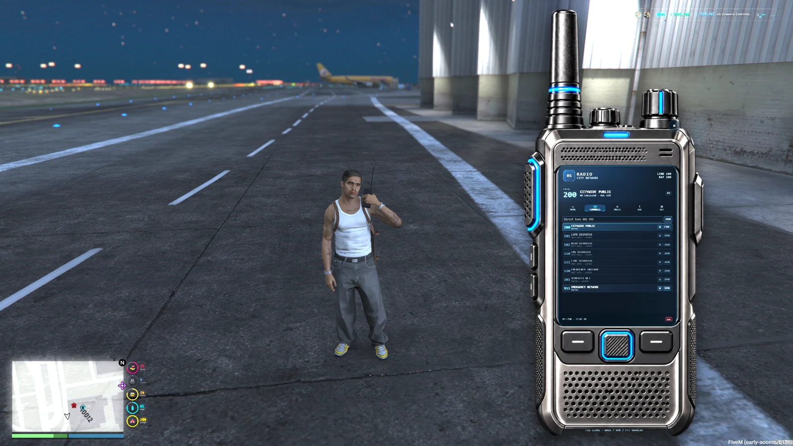

# RS Radio

A FiveM handheld radio with protected channels, unit rosters, emergency SOS, batteries, and RF jammers. Uses native voice on Enhanced and pma-voice on Legacy in automatic mode.

[Download ZIP](https://github.com/RealitySucksRP/rs-radio/releases/latest/download/rs-radio.zip) · [GitHub](https://github.com/RealitySucksRP/rs-radio) · [Website](https://realitysucksrp.github.io/) · [Store](https://reality-sucks-rp-webstore.tebex.io/) · [Discord](https://discord.gg/e9V3rPHySx) · [YouTube](https://www.youtube.com/@RealitySucksRP) · [Free scripts](https://reality-sucks-rp-webstore.tebex.io/category/free-scripts) · [Video preview](https://www.youtube.com/watch?v=KuSvMqt7jnw)

[Package documentation](PACKAGE-README.md)
