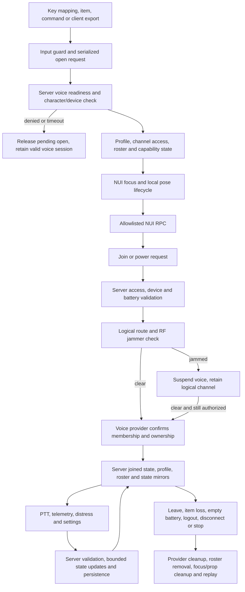

# RS Radio v1.0.4 production audit

Audit date: 2026-10-08. Scope: City Radio at `resources/[rs-resources]/rs-radio`, baseline v1.0.3. Result: repaired release candidate, with live release gates still open.

## Deployment baseline and scope

The inspected Enhanced `server.cfg` starts Qbox, ox_inventory, pma-voice and `rs-radioems`, with `voice_internal` and `sv_mumble` enabled. It does not explicitly start City Radio. The inventory's generic radio exports still reference `rs-zombieradio`; its EMS items reference `rs-radioems`. No local FXServer process was available during this audit. These are configuration observations, not proof of runtime activation.

Only City Radio files were modified. The server config, inventory data, pma-voice, bodyhealth, and the three specialized radios were inspected without edits. No resource was started or restarted. No external `rs_bridge`, SQL dependency, money action, garage, keys, fuel, target, or progress integration was added. Those systems are not part of this resource's gameplay flow.

The patch preserves display frequencies, callbacks/events/exports, existing profile/device IDs, both voice paths, distress, batteries, jammers, medical telemetry, movement settings, and sibling coexistence. The only route configuration change reserves City Radio's Legacy band at 20000-29999. The prior 20000-59999 band overlapped the bands reserved by the specialized radios, although the inspected configured channels had no actual duplicate route. Provider keys are internal; restart City Radio when applying the patch.

## Complete flow



Opening does not automatically join a channel. Closing the NUI does not turn the radio off: a valid voice session continues. The power button, frequency picker, shortcuts, or `JoinRadio` export request a server join. Configured team/role/ACE/job/gang access is resolved server-side. Job-mode channels require duty; team/role channels retain their existing assignment policy and do not acquire an implicit duty requirement.

The server activates the personal or physical device, loads its battery, validates access, maps the display frequency, checks local RF interference, and calls the selected provider. A failed switch revalidates/rejoins the former channel; failed recovery clears the session. Successful joins send authoritative channel/profile/capability state. Duplicate same-channel joins preserve a valid active PTT state.

On Enhanced, membership and mute/deaf gates are server natives. Key-down is a transmit request; key-up always passes through. The server checks the active session, current device/access, jammer, owner, observed ped health, and framework death/laststand metadata. Dead/downed transmitters are stopped, including a client that never sends key-up. Receiving and SOS behavior remain available; this audit did not impose a new receive-on-death restriction.

On Legacy, pma owns audio/PTT. RS validates its provider routes through channel checks and observes external channel changes. Its own writes are tagged; external work runs after the state-bag callback. A sibling takeover clears City's local session without writing provider channel zero over the winner. pma startup zeroes are ignored during a short recovery window; the gameplay layer restores authorized sessions after the provider starts.

Telemetry is sent only for configured telemetry channels. Server-observed position, health and armor replace client values. With no observed ped, no GPS/distress position is published. Medical labels, street/zone text and auxiliary vitals remain advisory client/provider presentation input; they grant no permissions or rewards. Privileged vitals views are filtered per recipient, and roster-only channels now receive no prior GPS/vitals/medical fields. Last-known entries expire after the configured retention period.

SOS toggles an active beacon, applies cooldown/expiry, resolves configured recipients, sends alert/board state, and supplies optional waypoint coordinates. The communication bus is server-local; an incoming normalized dispatch resolves channels/players/jobs/gangs/groups/departments/broadcast recipients and becomes a text traffic card. Each department retains its own duty policy. Ordinary traffic does not force the player away from settings.

Profile edits are normalized and persisted. A bounded per-session queue retains the last value for each setting and each configured favorite during bursts. Reset cancels queued profile edits and resets native deaf state. Recharge requires a confirmed server inventory removal, is throttled/locked, and persists the device's battery. Battery shutdown is applied only when the battery feature is enabled.

Jammer placement requires server permissions, a live observed ped, finite nearby coordinates and the placer bucket. It allocates/configures a server object before consuming an item. Failed setup deletes that object without spending. A successful paid placement records item recovery entitlement; free placement does not. Recovery locks the record, requires inventory acceptance, then removes the object/record. Full inventory leaves the unit recoverable. RF and nearest-unit interactions use the same bucket; clients receive only their bucket's unit list. Damage/despawn auditing removes dead/missing records. Persistent records are respawned on boot; duplicate record IDs do not overwrite a live object.

The pose uses a local cosmetic object. Dictionary/model awaits, queued open threads and watchdog replays check cancellation generation and ped identity. Close invalidates the generation before deleting the prop. Cleanup targets the ped whose pose was claimed, and cannot clear a replacement ped's tasks. Vehicle/death/ragdoll/swimming/climbing/cuff policies remain configurable. Primary-task cleanup inherited from the existing pose manager remains limited to a claimed animation and requires live regression testing with other emotes.

## Confirmed causes and repairs

| Finding | Original cause | Repair and proof |
|---|---|---|
| Legacy cleanup bypass through owner bag | Authorization read client-writable owner mirrors; a forged different owner suppressed pma disconnect | Private server ledger using existing server-only events. Spoofed mirror no longer suppresses disconnect; stale device still preserves a sibling's channel |
| Late open/focus takeover | Client serial existed only locally; replies could satisfy a newer pending request | Echo request ID in state/denial, reject stale replies before state mutation, recheck inventory input ownership |
| Old PTT callback changes a new session | Source IDs and transmit serials were reusable across sessions | Timer requires the original session object and serial; channel resets invalidate the transmit generation |
| Invalid native PTT remains allowed | Key-down checked channel/jam/owner but not fresh access/device/death | Revalidate on key-down and audit active native transmitters; never throttle release |
| Duplicate join silently mutes active PTT | Same-channel join reset native transmit without synchronizing local intent | Idempotent provider join and authoritative talking/profile/capability payload |
| Reset leaves native radio deaf | Profile/UI changed without resetting the native deaf gate | Reset applies the actual server deaf state |
| Free jammer yields an item | Removal returned an item regardless of whether placement consumed one | Persist explicit paid-recovery entitlement; free units return none |
| Placement/recovery loses items or races | Consumption preceded native setup; no per-unit recovery lock | Allocate before spending, delete failed setup, lock recovery and check inventory acceptance |
| Wrong inventory mutated | Item helpers chose any running ox inventory regardless of explicit selection | Honor the selected adapter throughout; require positive ownership/count and confirmed mutation success |
| New radios share battery identity | New metadata IDs were deterministically derived from character and item name | Generate distinct IDs for metadata-capable slots; preserve existing IDs and documented nonmetadata fallback |
| Cancelled pose overwrites a new prop | Model wait created into shared `prop` before checking the old token; queued threads captured token too late | Validate before committing, capture generation at scheduling, guard replay and ped replacement |
| Public roster leaks prior medical/GPS data | Cached telemetry was used when switching to a roster-only channel | Strip all medical/coordinate fields at server roster construction |
| Cross-bucket jammer UI | Server sent every unit to every client despite bucket-aware interactions | Filter delivery by recipient bucket and refresh while the UI is open |
| Settings vanish under rapid interaction | Debounce replaced pending patches; server dropped last updates | Merge browser patches and queue bounded server settings/favorites; reset clears pending edits |
| Dispatch traffic never appears | Client sent a `traffic` action that JS never handled | Escaped traffic card and emergency sound; tested with markup as literal text |
| Saved scale has no effect / panels leave screen | Entrance animation retained a transform over the saved inline scale | Opacity-only entrance; viewport fit and separate handset/overlay placement |
| KVP updates disappear after host permissions change | Every boot preferred writable JSON even after KVP held newer data | Durable KVP backend marker and runtime JSON-failure fallback |
| Custom defaults ignored | Normalization treated absent booleans/position as hardcoded defaults | Preserve configured defaults for new profiles; reject non-finite numeric settings |
| Disabled features still mutate gameplay | Zero battery export disconnected with battery disabled; jammer action could operate after feature disable | Feature gates respected; regression cases cover both |

The native baseline already released its own local route on stand-down. The cleanup bypass above was reproduced specifically with the Legacy adapter. Native bag trust was an authorization defect, not proof of an observed native membership leak.

## Why these solutions

A private ledger was chosen over requiring global strict state bags: it fixes City's trust boundary without changing every other resource's state policy or adding a dependency. Session identity and generation checks were chosen over longer timeouts/debounces, which cannot distinguish old work from current work. Placement-before-consumption avoids a fallible refund as the normal spawn-failure path. Item entitlement preserves paid recovery while removing the free-unit reward. Coalescing bounded final settings preserves user intent without removing controls. Reserved provider bands avoid relying on hashes never colliding across independently configured products.

The actual Enhanced voice API is probed before automatic selection. Bindings that exist but cannot execute can use available pma. After native operation has been confirmed, a later voice outage fails readiness instead of silently downgrading transport. Explicit backend configuration is retained.

## Compatibility and state matrix

| Path | Evidence in this audit | Remaining runtime proof |
|---|---|---|
| Qbox + ox_inventory | Installed Qbox event contracts inspected; mock identity precedence, metadata IDs, consumption and ownership checks | Actual character loading/unloading, transfer, item use and provider restart |
| QBCore + framework inventory | Adapter traced; positive-count gate and explicit provider behavior tested with mocks | Inventory forks, metadata save/reload and usable items |
| ESX + framework inventory | Capacity rejection and post-add count verified in mock; access/duty flow traced | Actual xPlayer inventory behavior and logout |
| Standalone/custom | Synchronous internal provider tested, including ox running beside it | Custom adapter must prove stable identity and synchronous successful mutations |
| Enhanced native voice | Official API sets checked; native creation/mute failure and transmit lifecycle simulated | Real audio, routing, native cleanup, startup without Mumble compatibility |
| Legacy pma-voice 7.0.1 | Installed server implementation inspected; provider disconnect/takeover and fallback simulated | Real audio/PTT, state timing, restart recovery and provider security limits |
| Sibling radios | Current config/ownership event contracts inspected; stale-device regression and channel maps checked | Two/three real devices and all installed versions; old siblings still trust their own bags |
| Bodyhealth | Installed `GetHealthStatus`/`GetHudVitals` contract mapped; native health remains distinct from anatomical state | Actual injury/downed/vitals display with both resources running |

Enhanced's native channel API avoids the client-controlled Mumble membership path. The current server's `sv_mumble` setting remains enabled for its wider installation; this patch does not change it. Native volume/per-listener mute limitations remain represented through capabilities. Legacy security still depends on pma/Mumble and cannot be certified by a radio source patch alone. See [Cfx voice](https://docs.fivem.net/docs/scripting-manual/voice/).

Player state is ordinarily client-writable. Ownership mirrors and shared radio bags are presentation state; City authorization uses private state. Shared replication is skipped when another sibling owns the player, avoiding a losing City's zero-state write over the winner. See [Cfx state bags](https://docs.fivem.net/docs/scripting-manual/networking/state-bags/).

## Validation and remaining release gates

- 50/50 executable Lua regression cases pass against the repaired resource; the original v1.0.3 baseline passes 11/50 under the same suite. These are scenario counts, not 39 separate vulnerability claims. Both result files are saved for comparison. The suite includes 1,000 malformed requests and 1,000 repeated offline leaves, with no item reward or repeated leave fanout.
- 16/16 Lua files compile using Lua 5.4; 2/2 NUI JavaScript files pass `node --check`; all three seed JSON files parse and remain byte-identical to the baseline. All explicit manifest assets and the sound glob resolve.
- 75 browser cases pass in headless Edge: six pages at 1280x720, 1920x1080, 2560x1440 and 3840x2160 with 75/100/120% requested handset scale, long text and 25 roster rows, plus request/profile/traffic checks. Panels remain in the viewport, have no horizontal content overflow, and do not overlap each other. A 1920x1080 screenshot was visually inspected. Browser QA is not CEF proof.
- Current four-resource channel maps have no duplicate configured provider routes. No remote Lua loader, mandatory SQL import, money mutation or external RS bridge was found in executable source.

Before release, start the exact patched City resource in a staging session, enable its detailed diagnostic, and test two real clients on allowed/denied channels. Exercise very short PTT taps, held transmit through death/laststand, job/duty/ACE changes, physical item loss/transfer, logout/reconnect/source reuse, sibling takeover, F11/Escape spam, inventory focus during an open roundtrip, resource stop/start, pma restart, bucket changes during jammer use, full inventory recovery, jammer damage and persistent respawn. Test both Legacy and Enhanced; native Enhanced should be exercised with `voice_internal` and no `sv_mumble` in that staging configuration. Capture idle/active resmon and profiler evidence.

Persistence remains debounced and is not atomic with external inventory mutations. A process kill between item recovery and durable world-record deletion can require manual reconciliation. JSON write/encode failures are logged; malformed stored data can fall back to defaults. A pre-v1.0.4 KVP store without a backend marker requires checking the intended source of truth before switching a formerly read-only host to writable JSON. Existing historical duplicate device IDs are preserved and need separate deliberate migration if an operator wants to split them. Old jammer records without recovery entitlement use the configured physical-item policy; historical free records created under other settings require review. Strict entity lockdown, prop models, vehicle seats, animation cleanup and physical damage need live artifact validation. These open gates prevent an unconditional production certification.

Distribution retains GPL-3.0-or-later metadata and `/onesync`, excludes development backups from the changed-files archive, and preserves all `data/` files. The working folder still contains old `.bak` files; they are not loaded by the manifest and should not be included in a future full release archive. Asset redistribution rights still require owner confirmation. [Cfx manifest](https://docs.fivem.net/docs/scripting-reference/resource-manifest/) and [release rules](https://forum.cfx.re/t/releases-rules-and-faq/240725) were reviewed.

## Changed files and installation

The changed-files ZIP contains these resource-relative paths only:

```text
CHANGELOG.md
config.lua
fxmanifest.lua
README.md
client/bridge.lua
client/main.lua
client/medical.lua
client/pose.lua
client/voice.lua
docs/PRODUCTION-AUDIT.md
docs/SECURITY.md
docs/STATIC-VALIDATION.md
docs/VOICE-OWNERSHIP.md
html/app.js
html/style.css
server/bridge.lua
server/channels.lua
server/main.lua
server/voice.lua
```

Apply over a backed-up v1.0.3 City Radio folder. Review the `BackendSpan` change if `config.lua` has been customized elsewhere. Keep all existing `data/` and KVP storage. Restart City Radio when testing. This patch neither enables City Radio in `server.cfg` nor changes currently selected item exports; configure those deliberately for the intended deployment. It does not replace or patch EMS/Police/Gang Radio.

## Primary references

- [Cfx securing events](https://docs.fivem.net/docs/developers/server-security/): server-derived validation and local-only event boundaries.
- [Cfx OneSync](https://docs.fivem.net/docs/scripting-manual/networking/onesync/) and [routing buckets](https://docs.fivem.net/docs/cookbook/2020/11/27/routing-buckets-split-game-state/): observed entities, bucket isolation and server entities.
- [Cfx Enhanced differences](https://docs.fivem.net/docs/developers/legacy-vs-enhanced/): transport/runtime differences.
- [Cfx native API-set data](https://runtime.fivem.net/doc/natives_cfx.json): verified server availability of object setup, health/max-health/armor, bucket and orphan-mode natives used here.
- [Qbox server events](https://docs.qbox.re/resources/qbx_core/events/server) and [client events](https://docs.qbox.re/resources/qbx_core/events/client): actual unload, metadata and group contracts.
- [pma official implementation](https://github.com/AvarianKnight/pma-voice/blob/main/server/module/radio.lua), also compared with the installed 7.0.1 tree.
